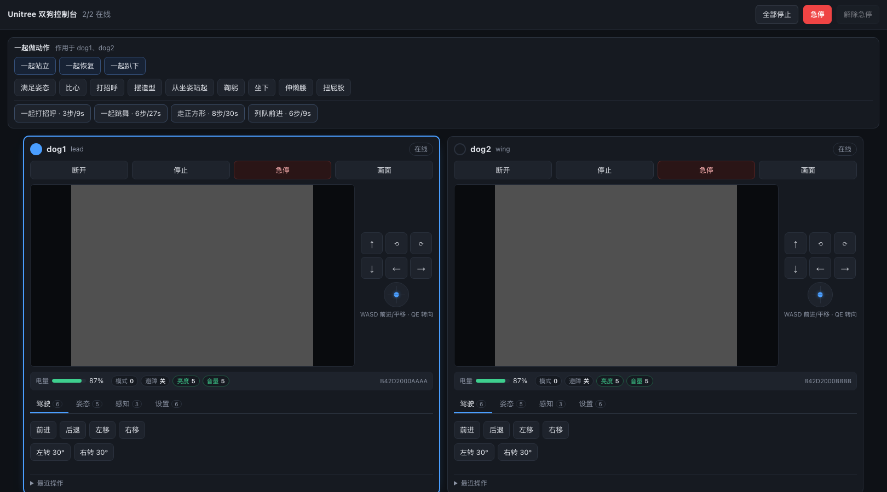
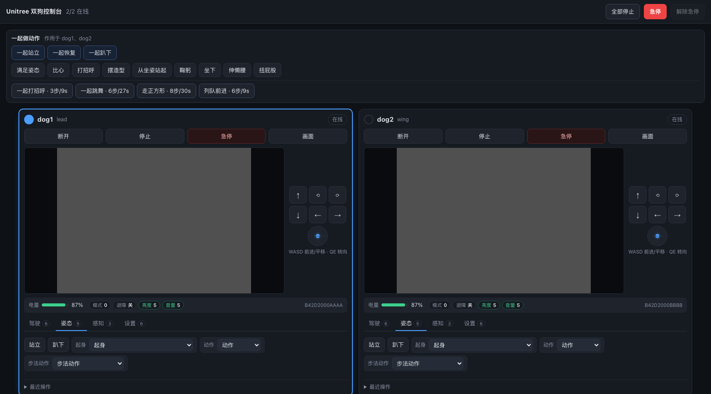
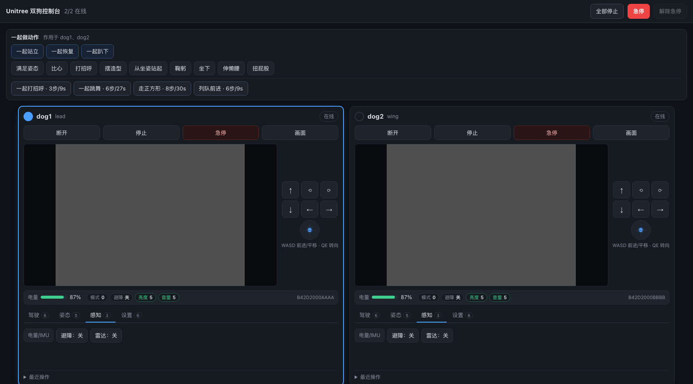
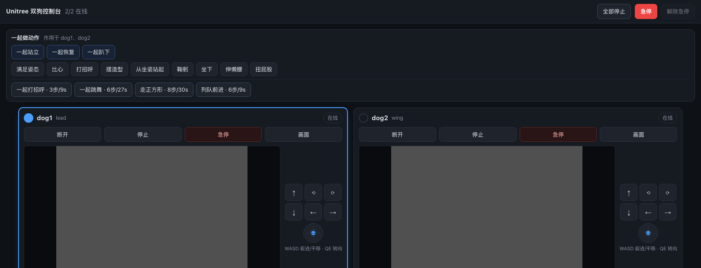
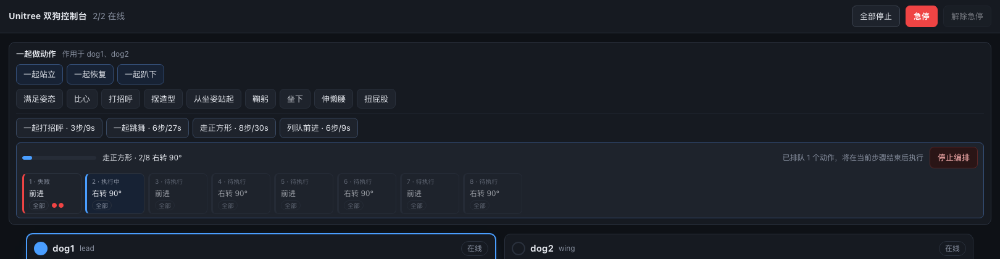

# 双机器狗 Web 控制台 — 核查、架构与实施计划

**目标** 一个**双狗 Web 控制台**：两台 Go2（固件 ≥ 1.1.15，`data2=3`）在浏览器里同时在线、各自可见、可遥操作、可安全接管与急停；一份共享 fleet 核心同时供 Web 控制台与 MCP agent 复用。

**工作分支** `feat/dual-dog-console`（自 `master`，master 已 fast-forward 到 `feat/unitree-robot-mcp`）
**日期** 2026-10-13 · **基线** = upstream `v2.2.0` + 自有提交
**方法** 只读考古：本地 git 对象比对 · upstream 全包分字节 sha256 比对 · `gh` API · `unitree_ui` 全量 clone 精读。结论均带证据。

---


## 界面

四个标签页 + 顶部「一起做动作」条。截图来自 mock 双狗（真机验证见 `HARDWARE_BRINGUP.md`）。

| 驾驶 | 姿态 |
|---|---|
|  |  |

| 感知 | 设置 |
|---|---|
|  |  |

编排运行中（顶部进度条 + 常驻停止按钮）：



## 0. 执行摘要与当前进度

### 三个前提的核查结果

| 你的前提 | 结论 |
|---|---|
| ①"去年的工作很初级" | **证实，且更糟：功能性死亡。** 入口 import 已改名的包、人体跟随闭环从未闭上、**连不上你的狗** |
| ②"没跟上作者新更新" | **订正，方向是反的。** 当前分支 = upstream `master` = `v2.2.0`，**零落后**。落后 11 个月的是 `wpp` 分支 |
| ③"`unitree_ui` 可借鉴" | **证实有价值，但多机部分无货**——它自己是硬编码单机。可借的是协议知识、数据表、反面教材 |

### 进度（截至 2026-10-13）

| # | 事项 | 状态 | 证据 |
|---|---|---|---|
| C1 | `master` fast-forward 到 `feat/unitree-robot-mcp` | ✅ | 纯 fast-forward（master 是祖先），非重写历史 |
| C2 | 建工作分支 `feat/dual-dog-console` | ✅ | `4806f3e` |
| C3 | 吸收 upstream PR **#63**（`%Z`→`%z` 时区） | ✅ | 干净落盘，无冲突 |
| C4 | 吸收 upstream PR **#66**（WAF 可诊断 + TLS 指纹可切换） | ✅ | 3 文件干净落盘；README 手工合并 |
| P0.1 | **可运行环境 + 测试全绿** | ✅ | Python 3.14.8 + aiortc 1.15.0；**318 passed**（接手时 collection 阶段即挂） |
| P0.4a | **离线 ICE 并发探针**（全案最大未知） | ✅ | 3 连接：transport 独立、端口零冲突、关一个不影响其余 |
| P1.1 | 身份层：`RobotSpec` + `Roster` | ✅ | `f4679fe`；重复 id / 同 SN / 同 IP 均被拒；每狗派生独立 `state_dir` |
| P1.2 | **per-device key store —— 修掉静默错配 bug** | ✅ | `f4679fe`；含回归测试 + 旧 `keys.json` 格式迁移 |
| P1.4–P1.5 | `robot_id` 进 config / audit；**audit 跨写 bug 修复** | ✅ | `8c9b52a`；每个 `AuditLog` 私有 logger；顺带修好 `to_stderr` 从不生效 |
| P1.7 | `FleetManager`：N 个 Runtime、逐台容错、诚实的 `stop_all` | ✅ | `8c9b52a`；20 个测试 |
| P1.8 | **连接隔离**：进程级串行 + discovery 下线程 | ✅ | `d579183`；实测 0.3s 阻塞扫描期间心跳仍在跑（≥10 tick） |
| P1.10 | **MCP 侧舰队化**：31 个工具加 `robot_id` + 4 个舰队工具 + 舰队资源 | ✅ | `fdeb289`；工具体一行未改（注册层用 ContextVar 绑定）；22 个新测试 |
| P1.11–P1.13 | **Web 操作台**（Starlette + 原生 asyncio + 双栏 UI） | ✅ | `aeeed6d`；端口实测 11/11 通过：estop 锁存→409→解除→200，MJPEG 真帧 |
| P2.1–P2.2 | 舰队急停（逐台结果）+ **锁存式** e-stop | ✅ | `aeeed6d`；舰队锁存不可被单狗解除收窄 |
| P2.x | **切换目标自动归零** + 死手看门狗 + Split 双人键盘 | ✅ | `7cc4549`；驱动归属按 source 分键，覆盖 Both/Split |
| P0.5 | `pyproject.toml`：aiortc 加上界、Python 提到 ≥3.10 | ✅ | `aiortc>=1.9.0,<2`；`requires-python>=3.10` |
| P3.1 | **故障目录 + 快照/增量 store**（从 unitree_ui 借鉴） | ✅ | `134248b`；修掉"快照被当成事件流"——旧实现答不了"现在哪里坏了"；31 个新测试 |
| P3.2 | **控制台故障面板**（逐狗） | ✅ | `134248b`；实机端口实测：dog1 显示 [System]+[Motor 1]，dog2 显示 [Emergency stop]，互不串台 |
| P3.3 | **控制台复用 MCP 工具**（不是第二份实现） | ✅ | `21448d1`；`ToolBridge` + 19 个白名单工具；confirm/safe-mode/审计全部继承 |
| P3.4 | 姿态与动作按钮（站立/趴下/动作下拉） | ✅ | `21448d1`；动作列表来自 `robot_list_actions`，不硬编码 |
| P1.14 | **操作员租约** + 显式连接/断开 | ✅ | `f9d6f36`；页面打开期间不再每 45s 断链；WS 关闭即释放，且**从不主动连接** |
| P1.15 | JS/HTML 契约测试 + JS 语法检查 | ✅ | `test_console_app.py`；`getElementById`/`data-role` 与模板比对；有 node 时 `node --check` |
| P3.5 | **`upload_file` 修复——它一个字节都没发** | ✅ | `e33c584`；修复前实测：`publish()` 进入 0 次、`send()` 0 条、却返回 `"ok"` |
| P3.6 | **手柄（Gamepad API）** | ✅ | `d6e5ea5`；映射抽成 `gamepad.js`（浏览器/ node 双用），15 个 node 测试；**测试抓到我的一个真 bug**：F1/F2 误映射到 A/B，按 A 会置两个位 |
| P3.7 | teleop 补齐 `ry` + `keys` | ✅ | `d6e5ea5`；此前只传 `lx/ly/rx`，物理手柄的**体转轴和所有按键被静默丢弃** |
| P3.8 | **驱动即连接**（不必先按"连接"） | ✅ | `d6e5ea5`；实测：两只狗都离线时发一帧，dog1 半秒内上线，dog2 未被触碰 |
| P3.9 | 下载侧核查 + 分块拼接测试 | ✅ | `e7d8be4`；**假设是错的**——下载本来就 await 并校验；真正的问题是它在返回 `bytes` 的函数里返回字符串 `"error"` |
| P3.10 | **真浏览器渲染测试**（headless Chrome） | ✅ | `ccc4ee2`；**首次运行就抓到真 bug**：WebSocket 一断，所有实时字段永远停在占位符；已加 HTTP 轮询兜底 |
| P3.11 | **最近操作面板** + 有界 audit 读取 | ✅ | `8eb3dfa`；`tail()` 原本 `readlines()` 全读再切片（5MB 轮转日志 = 解析数万行），改为从末尾按块反向读，实测 0.1ms |
| P0.3 | **`--preflight` 固件/`data2` 探测**（原列为"等硬件"，工具已就位） | ✅ | `f76476a`；**只读**：发 `con_notify` 但从不发 SDP，**不占用机器人唯一的 WebRTC 客户端槽**，可在官方 App 连接时运行 |
| P0.4b | **连接干扰测量仪**（原为最大未知 R4，工具已就位） | ✅ 工具 | `c10baf3`；`scripts/measure_connect_interference.py` 测的是**事件循环自身唤醒延迟**——遥测新鲜度只是代理量（机器人可能只是安静），而唤醒延迟**就是**损伤本身。12 个测试含"故意阻塞必被检出"与"礼貌让出必不误报" |
| P0.4c | 真机连接（单狗） | ✅ | **首次真机成功**：`B42N6000Q3UC1M8C`，`data2=3`+per-device key，3.39s 连上 |
| P0.5 | 真机遥测/视频/运动 | ✅ 单狗 | 电量 94–98%/32.0–32.3V、IMU、足端受力、1280×720@~4fps；`robot_stand`(code 0)、`robot_move` vx 3cm / omega 14°、`robot_stop`(soft_stop) 全部成功 |
| P0.6 | **真机发现：`rt/sportmodestate` 从不发布** | ⚠️ 未修复 | `go2_get_state.sport_state` 恒为 null，**Go2 没有步态来源**——数据不存在，不是显示 bug |
| P0.7 | **真机发现：遥测上限短于其包裹的读取** | ✅ `fd67a80` | 2s 上限 vs `collect_lowstate` 最坏 4s(Go2)/6s(R1) → 面板永远空且静默；mock 秒回所以 523 个测试全没碰到 |
| P0.4b | 真机双狗并发 + 连接干扰测量 | ⏸ **等第二只狗** | 网段只有一台；账户里第二只 `Go2_31437` offline |
| P3.12 | `--no-video-autoconnect`（纯观察模式） | ✅ | `c10baf3`；默认行为不变——"打开就能看见两只狗"正是目标所需；该开关让"只观察不占槽"成为一行命令 |
| P3.13 | **电量/姿态面板修复**（此前是死字段） | ✅ | `4c37585`；UI 读的 `session.state` 与 `robot.state` 都不存在——电量与姿态永远显示"—"；新增 1Hz 遥测采样器（与 4Hz 推送分离） |
| P3.14 | `watching` 同时计入 HTTP 状态请求 | ✅ | `4c37585`；此前只数 WebSocket——而轮询兜底正是为"socket 打不开"而生，那种情况下操作员会**既没有遥测也没有租约** |
| P3.15 | **视频健康状态**（说明"为什么没有画面"） | ✅ | `0a548c5`；连接正常、指令有响应、却永远没有画面的三种原因（无相机 / 视频通道未开 / 轨道结束）此前**外观完全一致**——一个空框 + "在线" |
| P22.1 | **编排改用"量出来的"行走** | ✅ `1345763` | `走正方形` 的前进腿原本是 `robot_move(vx=0.25, duration_s=0.6)` —— **按时长猜，而且猜四次会累积**。现在是 `robot_walk(meters=0.4)`。`列队前进` 让两只狗走**同样的距离**而不是同样的时长：两次一秒的移动在两块地面上不会走一样远，**而让它们保持齐平正是这条编排的全部意义** |
| P22.2 | **mock 走不了路** | ✅ `1345763` | `robot_walk` 在 `position` 上闭环，而 mock 的位置**在构造时就冻住了** → 每次量出来的行走都跑满 8 秒超时。mock **本来就在惰性积分朝向**（注释写明"这才让闭环转向能离线测"），只是位置从来没跟着积分。现在从同一个速度积分，用刚更新的朝向旋转 |
| P22.3 | **缓存不能撒谎** | ✅ `1345763` | `latest()` 返回 `self._cache.get(topic)`，而状态 topic **只在命令改变东西时**才重建 —— **但时间流逝不是命令**。现在有一张显式的"topic → 构建器"映射，读取时重建。**关键是按 topic 映射而不是按名字匹配**：第一版 `"sportmodestate" in topic` 看起来天经地义，却把 `rt/lf/sportmodestate` 喂成了 Go2 的四足载荷 —— **而那是 R1 的 FSM 状态**，`reported_state()` 于是报 `unknown`，自检从 20/20 掉到 18/20。**靠 stash 改动跑一次基线才发现**，那是唯一能确认"这个失败是你造成的"的办法 |
| P22.4 | **走不动就早点放弃** | ✅ `1345763` | 每步 8 秒、操作员盯着一个不动的进度条。被按住、爬不上的坡、里程计不动的机器人是**同一种情况：等下去没有用**。现在 1.5 秒没进展就停，报 `reason: "stalled"`；而**缓慢爬行的机器狗不会被误判为卡住**，因为比较的是**迄今最好成绩**而不是上一个采样 |
| P21.1 | **`robot_walk` 在倒着走** | ✅ `c2bcd56` | 发布那行写的是 `ly=YAW_AXIS_SIGN * sign * speed` —— **把偏航轴的符号约定抄到了前进轴上**。`YAW_AXIS_SIGN = -1.0`，它自己的注释明确说它存在是因为"负的 rx 产生正的 omega"。摇杆映射是 `[ly, -lx, -rx] -> [vx, vy, omega]`，**`ly` 直奔前进速度、不带翻转**。**而所有测试都过了** —— 它们查 `reason` 和 `actual_m`（都来自一个"让往哪走就往哪走"的模拟里程计），**从没断言过真正下发的方向**，而那正是循环唯一能"报成功却做错"的地方。现在断言线上的符号，并有反向的镜像测试 |
| P21.2 | **两个写者，一个 topic，没有仲裁**（实测） | ✅ `c2bcd56` | 工具直接发摇杆帧，控制台的运动环也发（50Hz，从斜坡目标）。**修前实测：操作员推着 W 时跑 `robot_walk` → 工具 297 帧、中间插进 3 个环的帧** —— 一只狗被以 50Hz 交替告知"走"和"停"；一般情况下还会被同时告知"走"**和**"听摇杆"。现在策略是：**持有运动窗口的工具拥有摇杆**，环让开；窗口关闭后恢复（第二条测试断言恢复，因为一个让控制台失灵的编排比撞车更糟） |
| P21.3 | **两次问错问题的测试** | ✅ `c2bcd56` | 第一版 spy 的是 `session.joystick`，它记录**两个写者**且无法区分，然后断言"环在窗口外发过帧"—— 而那是**合法**的：操作员推着 W 时工具还在做前置检查、尚未认领摇杆。改成 spy 环自己的路径才问对了问题。另外：守卫外层的 `contextlib.suppress(Exception)` 意味着**属性缺失会掉下去照发** —— 隔离验证过：`suppress` 里的 `continue` 有效，而 `AttributeError` 会被吞掉并继续执行。守卫今天是对的，但**如果那个属性被改名，它会朝危险的方向失效** |
| P20.1 | **从未执行过的运动端点** | ✅ `608e4c5` | `/api/robot/{id}/move` 是唯一**没有界面调用者、也没有行为测试**的路由 —— 它唯一的测试断言的是缺 token 时的 401，所以 `require_motion_allowed`、时长钳制和来源仲裁**在测试套件里从没跑过**。**和藏住 `robot_move`/`robot_walk` 错配的是同一类盲区**：一条因为存在而看起来接好了的路径。现在四条测试测的是**安全行为**而不是happy path：能走、急停锁存时 409、99999 秒的时长被钳制而不是照做、抢走别的来源驱动的狗会报告它归零了谁 |
| P20.2 | **每次使用都注册一遍的监听器** | ✅ `608e4c5` | `runFleetAction` **每次调用**都往 `#routine-stop` 上注册一个点击处理器 —— N 次舰队动作之后，按一下「停止编排」会发 **N 个停止请求**。单发测试看不见，第一次按也看不出问题。挪到 boot 只调一次的 `wireFleetBar`，并加了一条测试：**遍历那些会跑很多次的函数，任何一个绑了监听器就失败** |
| P20.3 | **边界插入终于有入口了** | ✅ `608e4c5` | 服务端从时间线那轮就有 `/api/fleet/routine/insert`，页面也从同一提交起就显示 `routine.pending` —— **但没有任何东西能往里放**，所以那个指示器只可能为 API 客户端点亮。现在编排运行时按舰队动作是**排队**而不是打断：`已排队 · 一起鞠躬（第 1 个）—— 当前步骤结束后执行`。**序列中途按"一起鞠躬"的意思是"这一步之后"，不是"扔掉剩下的"** |
| P20.4 | **两件死掉的东西** | ✅ `608e4c5` | `status().posture` 每秒发四次、**没人读**（页面的姿态显示来自 `body().fsm`）—— 载荷预算测试看不见这个：它只查总量，而一个没有读者的键是其中**没人会注意到在长的那一片**。`formation.py` 的 `DEFAULT_MAX_STEPS` 没有读者，因为 service 硬编码了 `6` |
| P19.1 | **每个数字带上自己的年龄** | ✅ `a3d567d` | 两套时钟从来不是问题（相机和遥测都用 `monotonic`）—— **问题是采样率不同**：遥测 1Hz、相机 10Hz、运动 50Hz。界面并排显示却不说哪个是旧的。**最要命的陷阱**：拿一张新的地图去比一个**旧的**速度读数，得出"狗没动"——而它一秒前刚起步。现在 `telemetry_health` 和 `body` 都带 `age_s`/`stale`，界面上写成 `3.0s 前的读数`（琥珀色，不隐藏：数字仍是现有最好的，只是不新） |
| P19.2 | **断线审计：四条真断线** | ✅ `de3b338` | 派子代理全面查"声明了、测过了、但两端从没接上"的地方。**安全那条**：故障徽章写着"2 条故障——点击查看"，而它指向的列表是**标签面板的兄弟节点，没有任何东西会取消隐藏它** —— 操作员看得到数量，**永远看不到是哪个电机、哪个码**。已移进感知页，**放在来源清单之上**（数据来源下面的诊断，是没人会滚到的诊断） |
| P19.3 | **`watching` 读错了端点** | ✅ `de3b338` | `renderStatus` 在状态推送里读 `payload.watching`，而 `status()` 从不发它 —— 只有另一个端点 `snapshot()` 发，而那个页面只在启动时取一次。**观看者那一行永远点不亮**，而提到它的测试断言的还是相反的契约 |
| P19.4 | **该存在的那个测试** | ✅ `de3b338` | `test_console_payload_contract.py`。原有的元素存在性测试检查 JS 去够的**元素**在不在 —— 而这四个 bug 涉及的每个元素**都在**，缺的是**数据**。新测试从 JavaScript 里**读出名字**（`renderStatus` 里的 `payload.x`，用花括号配对而不是正则到下一个 `function`，否则会静默地只检查一个片段），然后问端点发不发。**它当场就抓到了 `watching`** |
| P19.5 | **界面上一句指向不存在控件的提示** | ✅ `48a1fc3` | `per_source` 模式的提示写着"按输入设备绑定（下方 bind）"——**没有 bind 控件**，该模式解析不到任何狗、按键被接受但不驱动。**说出真相，是"这个模式不工作"和"这个控制台看起来坏了"的区别** |
| P18.1 | **走一条量出来的距离（闭环 forward）** | ✅ `73e02f4` | harness 五条里最后一条、也是唯一还没做的。它的两个闭环原语（`turn_deg` / `forward_m`）是那个仓库最有价值的东西，**转向那半我们早就有了**（正经的 IMU 偏航 P 控制器），这是另一半。`robot_move` 拿的是**时长**，而时长是猜的：0.6 秒走多远取决于地面、电量、步态，同一条命令每次走的距离都不一样 —— 建在它上面的一切（编队修正、走正方形的编排）都继承并累积这个误差。`robot_walk(meters)` 读位置、驱动、**量够了才停**；`arrival=0.85` 沿用 harness（最后几厘米是四足creep 和 stall 的地方，等满距离就是把技能变成超时）；**每条退出路径都归零摇杆** |
| P18.2 | **诚实的限制，写进代码也写进测试** | ✅ `73e02f4` | `position` 搭在 `rt/sportmodestate` 上，而**实测的那只 Go2 从不通过 WebRTC 发布它**（反复测过，同一只狗对其他请求都应答）。所以闭环经常没有东西可闭。这种情况**不藏**：退回按时长的移动并返回 `reason: "no_odometry"` 加一句说明 —— **一个被标注为猜测的猜测，而不是一个测量** |
| P18.3 | **删掉一个死掉的安全检查** | ✅ `73e02f4` | 第一版有个 `signed < -0.05` 分支用来放弃"走反了"的行走。唯一可测的量是距起点的 `hypot`，**永远不会是负数**，所以那个分支从来没触发过。**一个看起来像安全检查的死分支比没有检查更糟** —— 限制被写下来，并且用测试断言实际行为：被推着倒退的机器人照样记上那段距离 |
| P18.4 | **"看见 ≠ 移动"的教训又重演了一层** | ✅ `73e02f4` | 模拟场地路由了 `robot_move` 和 `robot_turn`；循环改用 `robot_walk`；命令发给了 mock 后端、狗没动、循环报 `no_progress`。路由的文档字符串现在写明：**循环能用到的每个工具都必须在这里处理**，因为这事还会再发生 |
| P17.1 | **界面上的编队控件** | ✅ `fa2780e` | "知道相对位置就不用手动调"的最后一层：填目标间距/方位/朝向差 → 点对齐 → **看它一步步收敛**。**跑在服务端后台**（一次最多六步、每步最多 2.5 秒，不能是浏览器等着的请求），进度走同一份 4Hz 推送 —— **安静二十秒的自动对齐，操作员会把它停掉然后手调**。每一步实时出现，历史从**服务端的记录**画（中途刷新页面仍然看得到已经走过的步） |
| P17.2 | **测试发现缺的校验** | ✅ `fa2780e` | `Formation(distance_m="far")` **被毫无怨言地接受** —— dataclass 不做类型检查 —— 然后几秒后在循环里炸掉，报的错和操作员填的表单毫无关系。`parse_formation` 改成强制转换 + 范围检查，**拒绝在操作员还盯着那个输入框的时候回来，并且点名是哪个字段** |
| P17.3 | **无穷和 NaN 走不了 HTTP** | ✅ `fa2780e` | JSON 没有无穷 —— 所以那一条**直接测解析器**而不是假装成请求。是防御性的而非可达的，但值得有：`Formation(distance_m=float("inf"))` 在 Python 里构造得出来，而且会让之后每一次比较**安静地为假**而不是抛错 |
| P16.1 | **闭环编队执行器** | ✅ `c92b19a` | 规划→下发→重看→决策。**对着一个"会回话的场地"测**：它从狗的姿态渲染画面，并在 `robot_move` 被调用时**真的移动它们** —— 这是唯一能验证"闭环存在理由"的办法：模拟狗的**最高速度故意和规划器的猜测不同**，所以每步都走不到目标，而测试证明**尽管常数是错的它仍然收敛**。静态回放相机会让循环在一张永不变化的图上"收敛" |
| P16.2 | **接线教的两件事** | ✅ `c92b19a` | ①**看见 ≠ 移动**：设 `_camera` 只让服务"观察"到模拟狗，把 `robot_move` 路由进模拟才让它"移动"它们。只接相机的结果是：循环在命令一只没人看着的真狗，同时测量一张永不变化的图 —— 而且它报的是 `no_progress`，**指向的位置离问题十万八千里**。②**替身的时钟要真实**：从 `time.monotonic()` 起而不是 `0.0`，因为检测循环会跳过时间戳等于上一帧的帧，而它自己从 0.0 起 |
| P16.3 | **四种停法，每种都比第五步更有用** | ✅ `c92b19a` | `converged` / `no_progress`（误差不再变小 —— 再走也修不好一个错的常数）/ `no_measurement`（狗出画或相机停更 —— **从过期位置继续开就是盲开**）/ `estopped`（**每步都查**，不是开头查一次） |
| P16.4 | **预算是量出来的** | ✅ `c92b19a` | 归一化速度换算之后，一步实际走 **0.22 米**（追踪出来的），所以默认六步闭合**约一米**。这是给"两只狗大致到位了"的修正，不是让它们穿过房间；超出的差距会报 `budget` 而不是一直挪到用完为止。**我第一版测试要求闭合两米然后挂了 —— 这个数就是这么量出来的，不是拍的** |
| P15.1 | **把地图的测量变成修正（编队几何）** | ✅ `d973fa0` | 平面几何，用手算能核对的图去测 —— 因为**这里一个符号错了就是把两只狗越推越开，而控制台报告说正在让它们靠拢**。两条约定：**朝向是鼻子方向**（0=+x，逆时针）；**`vy` 正数朝狗的左**。所以**面朝北往西走，横向项是正的** —— 我第一版把测试写反了，而这正是重点：**反过来读起来天经地义，直到你把它画出来**。加了镜像测试，符号翻转不可能同时骗过两个 |
| P15.2 | **为什么是闭环不是一次算准** | ✅ `d973fa0` | `robot_move` 的 `vx`/`vy` 是**对机器人自身上限归一化**的，不是 m/s，而且没人量过 Go2 的上限是多少。所以一条移动**没法下成"走 0.42 米"**，只能下成"用这个比例走这么久"。对开环是致命的，**对闭环只是慢一点**：相机每步之后重新测量，所以常数估错付出的是**迭代次数而不是精度**。`NOMINAL_MAX_SPEED_MPS` 是猜测而且**名字里就写着是猜测** |
| P15.3 | **换算写反了** | ✅ `d973fa0` | 第一版把**速度**按**时长的倒数**缩放 —— 于是**20 厘米的挪动被下令全速执行**。改成正确的方向：时长承载距离，`vx` 承载速度占机器人上限的比例。有测试断言**更短的移动不会被下令更快** |
| P15.4 | **自相矛盾的 plan** | ✅ `d973fa0` | `converged` 接受了 8° 的朝向差，然后规划器下令转 5° —— **花操作员一秒钟去修一个它刚判定为没问题的东西**。容差现在约束的是**指令**，不只是结论 |
| P14.1 | **在界面上点四个角完成标定** | ✅ `9483d0d` | 最后一件还要手写 JSON 的事。手写的后果是**一次会话带着一个微妙错误的标定开始**：四个数字从手机照片上抄来、顺序没人记下来。现在的流程是"对着一帧画面点四个角 → 填尺寸 → 保存"，**点错在保存前就看得见** |
| P14.2 | **点击坐标换算回原生像素** | ✅ `9483d0d` | 整条流程的关键换算：画面按面板宽度缩放显示，**坐标必须换算回原生帧像素**。记录显示坐标会让标定**恰好差一个比例** —— 这是这里最糟的一类错：**地图看起来完全合理，只是差一个倍数。** 有源码断言钉住，因为这种失败是静默的 |
| P14.3 | **退化标定照样能解出矩阵** | ✅ `9483d0d` | 先写测试才发现的：四个点共线、或有重复，**不会报错，会解出一个单应性**，然后反演出胡话。所以**在建矩阵之前先按四边形检查**（鞋带面积对外接矩形），并对两侧分别查重复点 |
| P14.4 | **"先有标定文件才能标定"的死循环** | ✅ `897f800` | 标定文件是**面板自己写出来的**，所以它不存在必须是**正常的起始状态** —— 而原来会因为文件缺失拒绝打开相机，**于是面板永远没机会创建它**。是新加的 `--arena-camera` 拿一个还不存在的路径实测时发现的，**而这正是操作员第一次会做的事**。现在三种情况分开：没文件=起始状态；文件读不了=报出来但相机照开（否则坏标定无法从能修它的面板里修）；没配路径=拒绝（面板也修不了） |
| P13.1 | **界面上的场地地图** | ✅ `7019b12` | 视觉工作的可见回报，也是控制台里**唯一显示"关系"而不是"数值"的面板**：两只狗在同一张图上。按**标定自己的范围**画而不是固定尺寸（画的和标定不一致的地图是在对距离说谎），两轴**同一个比例**（拉伸的地图会让正方形编队看起来是长方形，而操作员无法察觉） |
| P13.2 | **测量旁边放诚实的数字** | ✅ `7019b12` | 地面标定测出的间距被标记高度放大，所以图例**说出来了**而不是干给一个数：`间距 1.829 m` 旁边写`（地面标定，距离偏大 ×1.163 —— 实际约 1.57 m）`。**这一句就是"一个测量"和"一个被过度信任的数字"的区别。** 还标了"每格 1 米"—— 没有刻度的网格是装饰，有了就是尺子 |
| P13.3 | **空白不是一种状态** | ✅ `7019b12` | `off`/`starting`/`camera_failed`/`camera_stale`/`no_markers`/`error` 各有各的说法，因为**空场地和两只狗出画长得一模一样**而要三种不同反应 |
| P13.4 | **测试抓到我算了却没显示** | ✅ `7019b12` | 我在后端算了 bearing 却没画出来。断言 `bearing_deg` 在源码里的测试挂了 —— **挂得对**：**"另一只狗在哪个方向"正是编队需要的**，而只有距离给不出（"把间距缩小"在不知道间距在哪个方向时是有歧义的） |
| P12.1 | **场地相机 + 控制台地图** | ✅ `f08a0ae` | 相机**常开**（开一次摄像头是 USB 协商、要小一秒）；**只留最新一帧**（落后三秒的地图比没有更糟——它看起来是实时的），`decoded`/`dropped` 都报出来，**比值是"消费者跟不跟得上"唯一诚实的证据**；坏的相机是**状态不是异常**（控制台还要开狗）。`arena_state()` 区分 `off`/`failed`/`stale`/`starting`/`ok`——和来源清单同样的道理：**"没相机"、"有相机没标定"、"相机好但狗出画了"要三种不同反应，一张空图一个都答不了** |
| P12.2 | **FFmpeg 冲突：跑出来才知道** | ✅ `f08a0ae` | macOS 上 OpenCV 和 PyAV **各带一份 FFmpeg**，同进程加载会抢注册同一个 Objective-C 类，警告结尾是 *"may cause spurious casting failures and mysterious crashes"*。**实测的不是猜的**。修法不是回避（PyAV 是项目其他部分在用的），而是**惰性**：包里每一处 `cv2` 都在函数内 import，**不用视觉的会话根本不会加载它**（实测普通启动不触发）。有测试遍历 AST，**任何 `cv2` import 被挪到模块顶层就失败** |
| P11.1 | **检测器：一只相机读出两只狗** | ✅ `41bbca8` | 往返验证而不是看着像对：把标记按已知场地坐标投影进图像、检测回来、对比 —— **位置误差 3 毫米、朝向精确**（4 个位置 × 4 个朝向）。`vision_demo.py --simulate` 画出两只、读回、并排打印**读到的和画出来的** |
| P11.2 | **地板标定不够用（量出来的）** | ✅ `41bbca8` | 标记离地 35cm，地板单应性报的是"视线与地板交点"，误差是**以相机正下方为中心的径向放大** `H/(H-h)`。实测：2.5m 相机下**1 米读成 1.16 米**；**即使架到 8 米也超不过"半只狗宽"那条线**。不是放弃的理由（**两只被同一倍数放大，形状对、尺寸错**），而是**把标定靶垫到狗背高度**的理由——那样误差从构造上就是 0 |
| P10.1 | **可打印视觉标记（视觉定位第一步）** | ✅ `29483da` | 状态机同步做完了，开始做你一直想做的视觉定位。**为什么是相机**：两台里程计各有原点，同步模块只能测"动得有多不一样"、永远测不出"在哪"；**一台相机同时看两只就是同一帧同一个坐标系**。标记贴**背上**——狗看不见自己的背，相机必须是第三个在看的角色。36h11 可打印、真实尺寸、画了静区、**箭头指狗头**（贴歪 90° 会报出歪 90° 的朝向，检测本身永远不会说） |
| P10.2 | **检出下限是量出来的，不是抄口诀** | ✅ `29483da` | 前两次实验都"自信地错了"：**干净合成图** 8px 就过（那是在测渲染器，没有模糊噪声压缩）；**固定标记像素模糊**又全过（缩小标记没有让它相对更糊，而那正是远距离读不到的全部机制）。**真正咬人的是"按场景像素固定的光学模糊"**——镜头模糊量固定，标记越小占一格的比例越大。实测：σ≤1.8px 时 4万像素宽（5px/格）就够，σ=2.5 时需要 7px/格。常数放在 **8**（**高于**实测悬崖而不是压在上面），并断言余量还在。顺带修正 `CELLS_ACROSS` 10→**8**（实测），旧值让所有距离估计**乐观 25%** |
| P9.1 | **发现机器狗 + 生成 roster** | ✅ `556ed75` | `wpp` 最后一件没移植的成果。三条路**同时**试（多播 / 扫本网段 / 账号设备列表），因为**这片网络上没有单独一条够用**——实测多播一直不应答，**真正找到狗的是 /24 扫描**。多播静默时用**密钥试配**把序列号和 IP 接起来（`data2=3` 固件用自己的密钥加密握手，**能解密的那个密钥就是这只狗**）——是测量不是猜 |
| P9.2 | **两只狗是不同世代固件（重要发现）** | ✅ `556ed75` | 账号查出来的：`B42N6000Q3UC1M8C` 有 `dev.key`、**`B42D1000P4J7JC08` 为空** → 后者固件低于 `data2=3` 分界线，**根本不需要每机密钥**。**这正是"两只狗不一样"的一个具体来源**，而且现在**在会话之前就知道**，不是会话中才发现——所以探针**必须两只都跑**：一只静默的 topic 在另一只上不一定静默 |
| P8.2 | **一条命令收齐真机数据** | ✅ 本轮 | `scripts/session_report.py`：环境 + 只读体检 + 话题探针 + 连上采样，出一份 markdown **整份贴回来**。**绝不打印密钥**（用 roster 自己的 `redacted()`，不是手写过滤——**手写的那个才会漏**，有测试钉住）。为此把探针重构成"取数据"和"打印"两半（**两份 topic 列表 = 两个工具会对同一台固件给出不同答案**） |
| P8.1 | **看门狗没把零帧发出去（真安全 bug）** | ✅ `fee57e0` | 我在 wpp 里看到"按住 W 切窗口狗一直走"这个失效模式，**回来想写测试证明我们没这个问题——测试挂了**。运动环用 `commanded` 判断要不要发帧，而看门狗 `hard_stop()` **在两次 tick 之间**把它清零了 → 环认为"没什么可说的" → **一帧都不发** → 机器人继续执行最后一帧（`rt/wirelesscontroller` 上是一直走）。**看门狗的整个目的被一个判断优化架空了。** 改为比较**真正发出去的值**（`published`），且只在发送成功后推进（丢帧必须重试） |
| P7.1 | **wpp 深挖 + 空翻参数缺失** | ✅ `4427612` | 派子代理系统挖掘 `origin/wpp`（839 行报告，每条带 `origin/wpp:path:line` 引证）。**纠正了一个范围错误**：那个"54 文件 +16187 行"是相对 merge-base 的，wpp 实际只动了 6 个库文件、全是新的 `human_tracking/*`。**最有价值的产出**：发现四个运动动作（`Pose`/`FrontFlip`/`LeftFlip`/`BackFlip`）我们一直裸发 —— 示例里都传 `{"data": True}`。**失败模式最要命**：空翻什么都不发生 = 和"固件不支持"长得一模一样，没有错误码、没有日志、没有拒绝 |
| P7.2 | **两列布局：1440 笔记本上并排** | ✅ `a256b11` | 操作员说"完全是为竖屏设计的"——**实测找到了那条规则**：`minmax(460px,760px)` + `justify-content:center` 需要 **~1560px** 才用两列，而 1440/1512 正好是最常见的笔记本尺寸。改为 `minmax(min(100%,520px),1fr)`，**四档宽度截图验证**：1280 两列 / 1100 两列 / 1024 单列 |
| P6.2 | **舰队栏与键位图例** | ✅ `a256b11` | 舰队栏原本占 **~240px**（900px 屏幕的三分之一）才看到狗 → 压到 ~200px；键位图例原本对两组短键**折了三行**、把"哪个键、哪个轴"埋掉了 → 改成**键帽** `W A S D 平移` / `Q E 转向`，**用元素构建而非 `innerHTML`** |
| P5.1 | **双狗同步：测量分歧** | ✅ `7d3a94d` | `robot_turn(-90)` 是**各狗自己的陀螺仪闭环**，两只不会一致——地面摩擦、IMU 标定都不同，**结束时刻不同、停下朝向也不同**，走正方形转 4 次误差累积。先实测**已有的部分是对的**：命令下发间隔 **0.09 ms**（10 次采样，最大 0.17）。诚实问题：**各狗里程计各有原点**，直接比位姿无意义；有意义的是**各自相对同一基准的变化量**，所以由操作员按「标记对齐」。**绝不自动标定**——那是从两个不同源的里程计去猜物理世界 |
| P5.2 | **编排自动纠正** | ✅ `204c2c4` | 转向步之后，落后的那只补**一次、封顶 12°**。四种拒绝都有测试：非转向步、有狗拒绝了、未标定、已同步。**卡片上会显示 `已纠正 dog2 +12°`（琥珀色）**——偷偷转操作员的狗是不可接受的 |
| P5.3 | **长时间运行 + 租约 bug** | ✅ `90f5b29` | soak 测试（重连 25 轮 / 400 帧 / 100 个浏览器来回 / 反复编排 / 审计轮转 / 载荷不涨）**当场抓到一个真 bug**：合上笔记本或 WS 闪断时，租约把编排正在驱动的狗**全部释放并停车**，runner 继续对着已断开的机器人下发命令——**半个被释放的编排比两种极端都糟** |
| P5.4 | **真机会话脚本** | ✅ `3e24d50` | 明天现场用的有序脚本。**每条命令都先跑过才写下来**（初稿有两条是错的：`--preflight` 在控制台 CLI 上不在 agent CLI 上；没有 roster 控制台拒绝启动）。按"谁阻塞谁"排序，探针第一（只读，且它的 13 行决定后面能做什么）。含**症状对照表**——现场最贵的不是修，是丢失现场信息 |
| P4.1 | **status 载荷瘦身：7KB → 4.8KB** | ✅ `c36d927` | 实测而非猜测：7030 字节 × 4Hz = **每人 27.5 KB/s**（外加两路 MJPEG）。两成是浪费：`telemetry` 原始快照（1726B，页面只用其中三样，且都已被 `body`/`flags`/`where` 派生）和 `sources` 的静态文案（1520B，每秒推 4 次却只在 topic 状态变化时才变）。现 **4765B / 18.6 KB/s**，并有**预算测试**（<6000B）防止它一个字段一个字段地长回去 |
| P3.10 | **数据来源清单** | ✅ `2da587c` | 回答"为什么步态不显示？"——而且**把三种"没有"分开**：`有数据` / `未应答`（问了没答）/ `未读取`（控制台根本没读）。第三种最关键：`rt/utlidar/robot_pose` 没人读，空的位姿面板会被读成"这台机器人做不到"，而真相是"没人确认过"。两个列表**永不重叠**并有测试钉住；未读取的必须写明原因 |
| P3.11 | **JS 去取页面里不存在的元素** | ✅ `2da587c` | 我自己的测试抓到：`renderSources` 找 `[data-role="sources"]`，而它由 `renderControls` 动态创建——**能不能用取决于哪个函数先跑**。该元素现在在模板里 |
| P3.8 | **本体实时面板** | ✅ `24ac183` | **全部用真机已确认的 topic**：姿态气泡（俯仰是四足要翻的那个数，12°/25° 变色）、四根足端受力柱（腾空足=踉跄的最早征兆）、**实际速度 vs 斜坡指令**（单位不同，并排标注而非相减）。载荷缺席时返回空对象**而非 0**——"它是平的"和"它没告诉我"是两件事 |
| P3.9 | **卡住警告持续 1.5s 才亮** | ✅ `24ac183` | 刚被要求移动的机器人**还没动**；一个每次按 W 都喊狼来了的指示灯会被操作员无视，**比没有更糟** |
| P2.9 | **站立闸门（auto_stand）** | ✅ `c246bde` | 固件拒绝从趴姿行走（3201），操作员按 W 什么都不会发生。harness 用 `auto_stand` 解决，但它有 DDS 状态订阅、我们**没有**——**可我们不需要：控制台知道自己让机器人做了什么**。信念由自己的命令学习得到，连上第一个 tick 就有、零成本。代价说清楚：**学习而非观测**，官方 App 动过或狗摔了它就是错的——所以只用于一件事：决定要不要先发一条站立，而那对已站着的狗是 no-op |
| P2.10 | **闸门不能卡住运动环** | ✅ `c246bde` | `robot_stand` 内部等固件 1 秒，在环里 await 它**冻住了所有狗的斜坡**（与 WebRTC 握手阻塞事件循环同类）。实测冻了整整 1 秒。改为任务下发，并有测试：一只被闸门拦住时另一只斜坡必须继续 |
| P2.11 | **`hard_stop` 谎报 `estopped`** | ✅ `c246bde` | 「全部停止」和「急停」都切断，但只有一个锁存；面板在普通停止后显示"已急停"，会让操作员去找一个按了没反应的解除按钮 |
| P2.12 | **新页面按急停什么都没标记** | ✅ `c246bde` | `_zero_many` 跳过了还没有控制器的机器人，而没人驱动过的机器人就没有控制器 → 刚加载就按急停显示"空闲" |
| P2.13 | **删除不可达的 `damping` 分支** | ✅ `c246bde` | 锁存在驱动解析阶段就拦住了，而唯一会阻尼的工具不在白名单里——**带着漂亮注释的死代码也是死代码** |
| P2.7 | **摇杆取代方向键盘** | ✅ `eb93763` | 六个方向键是**两个连续轴上的六个二值输入**：按不出"半前进"，走斜线要同时按两个。改为可拖拽摇杆，与 WASD/QE 同一对轴——**键盘是一等公民**，旋钮跟着按键动。三条容易做错的：`setPointerCapture`（快速拖出圆外不失控）、**单位圆盘**钳制（方形四角会给 1.41 倍）、四种情况归零（`pointerup`/`pointercancel`/`lostpointercapture`/窗口失焦） |
| P2.8 | **"在哪"有了答案（在有答案的时候）** | ✅ `eb93763` | `position` 搭在 state topic 上——和步态同一个，**零额外读取**；机器人不发布就**不渲染**（0 会被读成"测量值"，而"没动"和"没告诉我它在哪"是两回事）。**刻意不做共享地图**：每只狗里程计各有原点，画在一套轴上等于编造一个不存在的关系 |
| P2.1 | **服务端速度斜坡 + 看门狗 + 转向耦合** | ✅ `b4de033` `882724d` | 借鉴 unitree_harness 的 mover 线程：加速 0.5/s、减速 1.0/s（**起步柔、收手狠**）、50Hz 重发、看门狗减速而非切断、`vyaw_limit = max(0.25, 1-0.75*速度比)`。真机/浏览器路径实测：推满 0.02→0.89 平缓加速，松手 stopping 0.93→0.00 减速 |
| P2.2 | **`/api/fleet/teleop` 此前绕过斜坡** | ✅ `882724d` | 浏览器实际走的是这条路径，改 `teleop` 时漏了它——**斜坡对真实 UI 完全没生效**。驱动它、盯着 `commanded` 一直是 0 才发现；单元测试全绿因为测的是另一个方法 |
| P2.3 | **`rt/lf/sportmodestate` 才是对的 topic？** | ✅ `882724d` | R1 profile 一直读 lf 版，Go2 读的是真机上静默 8 秒的那个。**更关键：两个 topic 不是替代而是字段互补**——lf 有 `fsm_id`，另一个有 `gait_type`/`position`；取第一个应答的会丢字段（mock 上直接丢了步态）。现在合并 |
| P2.4 | **WebRTC topic 探针** | ✅ `882724d` | `scripts/probe_webrtc_topics.py`：一条命令回答"这条链路实际给什么"。**只读**。mock 演练 4/13，位姿/雷达/地图全部 silent——这正是动手写代码前该看到的警告 |
| P2.5 | 客户端响应曲线（死区 0.08 + 平方） | ✅ `882724d` | 小按键=小速度；低速度正是两只狗在房间里挪动时最需要的 |
| P2.6 | **驱动状态上屏** | ✅ `882724d` | 空闲/行驶中/减速中/看门狗停车/已急停 + 指令向量；摇杆点变琥珀色 = 目标远大于实际指令（卡住） |
| P3.5 | **在页面上编写编排** | ✅ `2755e1b` | 上轮编排已是文档，但**只能 curl 写**——这正是 wpp 掉进的坑（序列是 Python list，"除了作者没人写过一条"）。调色板来自**两个实时源**（fleet actions + 每狗控件），所以编排就是用**这台机器人实际注册的操作**拼出来的；每行带"等多久"和"几只狗做到算成功"；排序用 ↑/↓ 而非拖拽（**拖拽对鼠标友好，对键盘和触屏不可用**，共用控制台不该绑定某一种输入设备） |
| P3.6 | **中文名保存的 id 回退** | ✅ `2755e1b` | 中文名没有 ASCII 可派生，回退到哈希；有测试断言**服务端接受编辑器产出的 id**，否则"保存"对用中文的人**静默失效** |
| P3.7 | **调色板的时序竞态** | ✅ `2755e1b` | `loadPalette` 读 `focusMap`，而它要有 pens 才有内容；它排在 `buildPens` **之前**却"看起来能用"——因为内部 `await` 让 pens 先建好了。**这是竞态不是设计**，那天 fetch 变快就会坏 |
| P3.1 | **编排成为文档 + 时间线 UI** | ✅ `ca822fe` | 借鉴 wpp 并修掉它两个致命弱点：①"只能改 Python 才能编排序"→ 现在是可校验的文档、可存盘、自定义与内置并存；校验同时取代了它那个 `getattr(module, f"{action}_single")`（任何公开方法都能被 HTTP body 调到）②"bool 不是结果"→ 每步有完成策略（all/any/best_effort）+ 终态（pending/running/done/failed/cancelled）**且内含每狗明细** |
| P3.2 | **编排运行前整条时间线可见** | ✅ `ca822fe` | `start_routine` 先返回全部步骤为 `pending`——这才叫时间线而不是"带标签的日志"；UI 每步一张卡 + 策略徽章 + **每狗一个点** |
| P3.3 | **边界插入** | ✅ `ca822fe` | 操作员临时想"一起鞠个躬"会排在当前步之后，而不是替换整条序列（wpp 的 `dance_triggered` 有这个直觉，但藏在会跨重启泄漏的 bool 里、且只被两个循环中的一个认） |
| P3.4 | **走正方形第一步就失败（真 bug）** | ✅ `ca822fe` | 固件拒绝从趴姿 `robot_move`（3201 "not standing; BalanceStand first"）；**是时间线把它显示成红卡才发现**。并加了"每条内置编排端到端跑通、无一步失败"的测试 |
| P1.19 | **编排（routines）——借鉴 wpp 的 MovementPattern** | ✅ `1371560` | 这是控制台此前缺的**编排层**：能做"一个动作"，不能做"一串动作序列"。按现在的情况加强了 wpp 原版的四处问题：①中止能力（原版取消任务+StopMove 不够；这里急停/停止都直接取消，步内等待切 200ms 片）②失败只有 bool（原版 `sum(results)>0` = "至少一只做了"；这里逐狗点名）③时长靠 if 链猜（改为声明并显示在按钮上）④绕过安全层（改为走同一套受守卫的工具）。**原版 `FOLLOW_LEADER` 是死枚举**（无分支、永远返回 False），未沿用 |
| P1.17 | **🔴 急停锁存此前不覆盖面板** | ✅ `561d8e0` | `call_tool` 直接进工具，而工具不知道控制台的锁存——**急停后按"站立"/"打招呼"机器人照样会动**；锁存此前只挡摇杆。现按 `MOTION_GATED_TOOLS` 拒绝（409，与 teleop 一致），读取不受影响 |
| P1.18 | **一起做动作（舰队动作）** | ✅ `561d8e0` | 全新的第二场景：姿态行（一起站立/恢复/趴下）+ 实时目录里安全动作的一半（打招呼/伸懒腰/坐下/比心…）；**并发下发**而非循环；**未连接的狗会被点名**；标签与面板共用一张表 |
| P3.21 | **驾驶易用性**：速度档 / 摇杆可视化 / 按键高亮 | ✅ `561d8e0` | 首次驱动真狗前把整体调轻；屏幕方向盘兼作读数（按住的键会点亮对应箭头）；摇杆圆点画出**实际发出的轴值** |
| P3.20 | **布局大修：双列 + 标签页 + 图/盘同排** | ✅ `55e2ee2` | 此前是**单列纵向堆叠**（竖屏版式套在桌面窗口里）：宽屏大量留白、方向盘埋在画面/遥测/故障/四个区块之下。现在两狗并排、图与盘同排、遥测成条（电量带阈值色条）、控件分四个标签页、故障徽章置顶常驻 |
| P3.18 | **控制面板重构**（声明式控件表） | ✅ `9c813a7` | 此前暴露 22 个工具却只渲染 **4 个**控件——避障/雷达/运动模式/灯光/亮度/音量/手势/动作目录全部只能 curl；现按 `controls.py` 声明式渲染，Go2 20 个控件 6 组、R1 12 个；真机 Chrome 验证 |
| P0.8 | **`go2_recover`**：摔倒后站起来 | ✅ `9c813a7` | `StandUp 1004`/`RecoveryStand 1006` 一直在 `SPORT_CMD` 里，但 `_DEDICATED` 把它们排除出动作目录——**此前没有任何工具能送这两条命令**，摔倒的狗站不起来 |
| P3.19 | 控制台放行 `robot_move`/`robot_turn` | ✅ `9c813a7` | 反转了原设计：有界自终止的移动**比按住按键更安全**（没有键要松、没有东西会被按住） |
| — | **不加步态设置** | ⛔ 刻意不做 | `SwitchGait 1011` 只有命令 ID，**全仓库没有任何合法取值枚举**；给真机猜一个数字 payload 正是本项目反复吃亏的失败模式。"步法动作"组改为四个一次性动作，并明说不是持续步态 |
| P3.16 | **自审：两处泄漏** | ✅ | `2541ced`；`frame()` 未校验先建锁（未知 robot 留下条目）；**自动连接任务活过进程关闭**（实测关闭后仍有 1 个任务挂着 30s 睡眠）。并修掉两个**看起来有覆盖实际永远不可能失败**的测试 |
| P3.17 | **可达性：README 与 skill** | ✅ | `b9e48cf`；此前 README **完全没提**控制台，skill 的工具地图也早于机队工作——**agent 会省略 `robot_id`，从而动了名册默认那只**（安全相关）；两处均已补，并用测试钉住 |
| P1.16 | **离开即交还链路**（"可安全接管"的另一半） | ✅ | `ed655fc`；此前浏览器关闭后要等 `idle_disconnect_s`(45s)+租约一拍 ≈ **50s** 才能让官方 App 接管；现在 `unwatched_release_s`(默认 10s) 主动交还，且**交还前先停车** |

**P0.4a 的实测结论（最重要的一条）**：`unitree_webrtc_connect/__init__.py:1-17` 把 ICE 凭据钉在**类属性**上，进程内所有 peer connection 共享同一组 ufrag/pwd（实测 3 条连接只有 1 个 ufrag）——**但这不构成阻塞**：3 条连接拿到 3 个独立 transport，36 个 host candidate **端口两两不同**，关掉第 0 条另两条存活。

> ⚠️ 共享 ufrag 只在**各连不同远端**时安全。这意味着机器人"只接受一个 WebRTC 客户端"这条约束必须由 fleet 层**强制**，而不是靠竞态。

### 现在怎么用

一份 `fleet.json` 同时驱动两个前端（Web 控制台与 MCP agent）：

```sh
cat > fleet.json <<'JSON'
{ "default": "dog1",
  "robots": [
    {"id": "dog1", "model": "Go2", "ip": "192.168.31.245", "sn": "B42D2000AAAA", "role": "lead"},
    {"id": "dog2", "model": "Go2", "ip": "192.168.31.246", "sn": "B42D2000BBBB", "role": "wing"}]}
JSON
export UNITREE_AGENT_ROSTER=$PWD/fleet.json

unitree-fleet-console --backend mock          # Web 控制台，无机器人演示
unitree-fleet-console --backend webrtc        # Web 控制台，真机（狗上线后）
unitree-robot-mcp selftest                    # MCP 离线自检（对 roster 免疫，20/20）
unitree-robot-mcp serve                       # MCP server，工具自动带 robot_id
```

浏览器打开 `http://127.0.0.1:8765`。每只狗一栏：实时画面、电量/状态、**故障面板**、虚拟摇杆、姿态按钮（站立/趴下/动作下拉）、停止/急停。

- 键盘 `WASD` 前进/平移、`QE` 转向；`Split` 模式下第二只狗用 `IJKL+UO`——**一个操作员同时开两只**。
- 急停是**锁存**的，必须显式解除；舰队级锁存不能被单狗解除收窄。
- 姿态/动作按钮走的是**和 MCP 完全相同的受保护函数**（`/api/robot/{id}/tool`，19 个白名单工具），所以 `confirm`、危险动作闸门、safe mode、限流、审计全部继承。按钮发 `confirm: true`——人点按钮本身就是确认；与"人的意图"无关的闸门（safe mode、危险动作白名单）仍然会拒绝。
- 每只狗的 **连接/断开**按钮：从官方 App 手里把链路要回来，或主动交还，都不必先发一条运动指令。
- 每只狗的 **最近操作**折叠面板：走的是每狗独立的审计轨迹（密钥在写入时已脱敏）。被拒绝的指令也会如实记录（例如 `robot_stand` 缺 confirm 记为 `ok=false / confirm_required`）。
- **打开页面会自动连接两只狗**（视频默认开启，拉流会 `ensure_connected`）——这正是"可同时在浏览器中可见"所需；若官方 App 已占着槽位，连接会以 `robot_busy` 失败并显示离线，**不会把谁踢下线**。
- **页面打开期间链路不会被释放**（操作员租约），**离开约 10s 后主动交还**（交还前先停车）——这样主人不用在狗旁边等近一分钟。租约只**阻止释放**，**从不主动连接**；没人要的狗保持离线。

MCP 侧先调 `robot_roster` 拿 id；每个工具都接受 `robot_id`，省略则作用于名册默认狗。停止全部用 `robot_stop_all`，并**必须检查 `not_stopped`**——链路不通的狗会列在那里，它没有停下。

### 立刻可做的下一步

1. **狗上线时，两条命令**（唯一剩下的硬阻塞）：
   ```sh
   unitree-fleet-console --preflight        # 每台狗：可达? data2=? key 对不对? 只读，不抢槽
   unitree-fleet-console --backend webrtc   # 真机
   # 以及并发测量：
   python scripts/probe_dual_connection.py --ips <dog1>,<dog2>
   python scripts/measure_connect_interference.py --ips <dog1>,<dog2>
   ```
2. **控制台增强**（不需要机器人）：目前只剩细节——例如把 `robot_lowstate`/`robot_get_posture` 的实时遥测（速度/IMU/网络）也铺到面板上。
3. **驱动侧**：`upload_file` 已修，但 `request_static_file`（下载）走的是同一条 fire-and-forget 路径，值得按同样的方式核一遍。

---

## 1. 核查：`wpp` 分支为什么不能直接用

`wpp` 对 SDK **一个文件都没改**（纯追加 52 个文件），所以没有合并冲突，只有"新固件上完全跑不通"：

- **入口已死**：`dual_dog_main.py:166` 还在 import 改名前的 `go2_webrtc_driver` → `missing_deps` 非空 → `sys.exit(1)`。
- **人体跟随闭环从未闭上**：`human_tracking/video_processor.py:117` 在工作线程里调 `asyncio.get_event_loop()`，必然 `RuntimeError`，被 `except` 吞掉，**每条 PID 指令静默丢弃**。且 `if human_bboxes:` **没有 else** → 目标丢失后最后一条速度留在机器人上，**狗会继续走**。
- **连不上你的狗**：`dual_dog_controller.py:113-121` 完全没有 `aes_128_key`；`unitree_auth.py` 只有 `data2 == 2` 分支。你的 Go2 是 `data2=3` → 握手在 `rsa_load_public_key` 就炸，报的还是一个看起来像"网络问题"的 traceback。
- **没有协同层**：所谓"双狗同步" = 同一按钮扇出两条 `create_task`（`:312`）。唯一承诺协同的 `MovementPattern.FOLLOW_LEADER`（`dual_dog_movement.py:24`）**全仓库零引用**，`start_pattern` 直接 `return False`。
- **测试 11 个文件，0 个 `assert`**；文档 5,722 行（比应用代码还多）是 AI 会话报告。

**判决：不 merge，前向移植想法。** 唯一原样带走的结构资产是 `web_server.py:95-127` 的 loop 引导模式（我们改用原生 asyncio，见 §4）。`static/css/style.css`（616 行纯 CSS）可原样复用。

**不要 `git checkout origin/wpp -- .`**：会删掉 `unitree_cloud.py`、`_cli.py`、`LICENSE` 和 10 个 example 目录（`git diff --name-status caf1def origin/wpp` 里**一个 `D` 都没有**——那些是 upstream 在分叉**之后**新增的）。

---

## 2. 关键事实

### 2.1 分支地形

```
caf1def (2025-10-06)  ← wpp 分叉点
   ├──► origin/wpp 8122545 (2026-03-27)   11 commits，+52 文件，SDK 零改动
   └──► origin/master e0abc57 (2026-08-16) = tag v2.2.0 = PyPI 2.2.0   32 commits
             └──► feat/unitree-robot-mcp c325794 (2026-09-14)  4 commits（MCP + skill + 瘦身 + 测试）
                       └──► master（已 FF）► feat/dual-dog-console  ★ 我们在这里
```

`origin/2.x.x` 是上游历史遗留线；本地 `54cecf3` 是 fork 专有的 wpp 合并，**已无价值**。

### 2.2 你的机器狗：`data2=3`

| 机器人 | 固件 | 认证 | 当前分支 | `origin/wpp` |
|---|---|---|---|---|
| Go2 | 1.0.19–1.0.25 / 1.1.1–1.1.14 | `data2=2` 静态 | ✅ | ✅ |
| Go2 | **≥ 1.1.15（你的）** | `data2=3` per-device | ✅ `aes_128_key=` | ❌ |
| G1 / R1 | — | `data2=2` / `data2=3` | ✅ | ❌ |

key 是 per-device、跨重配对稳定，存于机器人 `/unitree/etc/key/aes_key.bin`，云端以 `dev.key` 出现在 `device/bind/list`。

**⚠️ 一个必须修的静默错配**：`unitree_robot_agent/config.py:295-322` 的 key 缓存按 `device_type:sn_or_ip` 索引，**但有 family 兜底**——第二台同型号狗只配 IP 时，family 兜底会把**狗 #1 的 key 交给狗 #2**。失败形态是 GCM tag 校验不过（`AesKeyRejectedError`）。双狗场景下这是**必然踩到**的路径。

### 2.3 当前分支离双狗有多远

**好消息**：单机设计扎实——`RobotSession` 自带 `Guard`/`SessionStats`/connect 锁/holder 计数/空闲看门狗；profile 无实例可变状态；mock backend 658 行全部状态在 `self` 上，能模拟 811→830 重定向、冻结状态上报、1001/1003 拒绝、`RobotBusy`、真 JPEG 帧、yaw 积分闭环。**没有任何东西架构上敌视 2 台。**

**阻挡点是身份，不是机器人接口**：

| 级别 | 差距 | 证据 |
|---|---|---|
| **R1** | audit logger 是进程级单例，`robot=` 只有**型号名** | `core/audit.py:27,116-131`；`context.py:56,98,110`；`session.py:140,164,410,439`。**已实测复现互相污染** |
| **R2** | 一个 `ToolContext`/`Runtime`/31 个工具全部闭包捕获它，**无 target 参数** | `server.py:88-104`、`tools/context.py:27-31` |
| **R3** | 无身份的共享 state dir | `config.py:216-232`（keys.json family 兜底）、`auth.py:175-182`（`clear_session()` **删整个文件**）、`capture.py:186-268`（快照索引无 robot id + `index.jsonl.tmp` 固定名竞态） |
| **R4** | `conn.connect()` 里的阻塞 I/O 直接在 loop 上 | `webrtc_backend.py:115-122`（只构造函数下线程）、`webrtc_driver.py:64-84`、`unitree_auth.py:205-224`、`multicast_scanner.py:68-70`（UDP 10134 单 owner） |
| **R5** | 无舰队急停、无协调 | `locomotion.py:49-66`、`session.py:391-400`（链路断时**不碰机器人就返回 False**）；全包 `collision\|fleet\|coordinat` 零命中 |
| **R6** | `AgentConfig` 运行时被改写 | `config.py:346-376`、`auth.py:200,450-451` |
| **R7** | 视频：回调**串行** await，第一个 `while True: recv()` 会饿死第二个消费者 | `webrtc_video.py:24-33`、`webrtc_backend.py:322-354` |
| **R9** | `FutureResolver` 兜底 key = `f"{type} $ {topic}"`，且一次性 resolve 该 key 下**所有** pending future | `msgs/future_resolver.py:113-120`。**加第二台之前必须先修** |

**约走了 30–40%。** R1–R3、R6、R9 是低风险机械改动；R4 是真项目。

### 2.4 `unitree_ui` 能借什么

**明确不能借**：它**没有**多机支持（`app.ts:2515-2519` 已连接时再连会**拆掉原连接**；`heartbeat.ts:4` 模块级单例定时器；`data-channel.ts:14` 单槽 response handler，其 `docs/slam.md:257` 自认"并发会踩坏响应链"）。**因为它从不复用连接，里面根本没有多机延迟/带宽方案可抄。**

能借的（按性价比）：故障目录 + 每电机合成（我们的 `app_error_messages` 只有 33 条、只到 source 600）· 故障快照/增量语义（我们现在是追加，答不了"现在哪坏了"）· **per-chunk ack**（我们的 `msgs/rtc_inner_req.py:98-141` 的 `upload_file` 是 fire-and-forget，**永远返回 `"ok"`**）· 急停 `header.policy.priority=1` + 按机型分支（Go2 1001 / G1·R1 7101 `{"data":1}`）· 输入源仲裁模式 · BLE 配网（`server/ble_server.py` **本来就是 Python，可直接 vendor**）· USLAM 命令表。

**许可**：MIT，同一个作者 → 复用零障碍。

---

## 3. 范围收紧：N → 2，改变了什么

| 议题 | N 狗方案 | **双狗方案（我们的）** |
|---|---|---|
| 视频 | 只有焦点狗开流 | **两路都默认开**。这是控制台的核心价值：同屏看两只。带宽靠**每路分辨率/fps 上限** + "省流模式"（一路实时 + 一路缩略图）控制 |
| 订阅 | 焦点驱动订阅集 | 两狗都订阅**状态**；视频可独立开关 |
| 互锁 | "同一时刻只允许一个 mover" | **太保守**——双狗的用法大多是同时走。改为：**默认允许同时移动**，配 `STOP ALL` + 逐狗 e-stop + 可选"串联模式"（一条指令发两只） |
| 协同 | 编队原语泛化 | 直接做 **leader/follower + 固定偏移**，以及 Go2 自带 lead-follow（注意 `SPORT_CMD` 把 `LeadFollow`/`FreeWalk` 都映射到 1045，`robots/go2.py:14-16` 因此**故意排除**，需先消歧，不能简单放开） |
| 前端 | 可扩展列表 | **固定双栏**布局，为 2 台优化，代码仍按 dict 写以便日后扩到 N |
| 输入 | 焦点 + 仲裁 | **这是双狗控制台真正的设计难点**，见 §6 |

**架构仍按 N 写，UI 按 2 优化。** 这样不牺牲未来的扩展性。

---

## 4. 目标架构

一份共享核心，两个前端。**不做 package 大搬迁**——避免动那 8,789 行已有 158 个测试覆盖的代码。

```
unitree_webrtc_connect/          ← 上游 vendored 驱动。保持字节对等，只留有记录的补丁
                                    （现有 3 处：懒 pydub / 懒 LiDAR / 删未用 import）
unitree_robot_agent/             ← per-robot 核心 + MCP 面（已有，改动最小化）
  core/ backends/ motion/ vision/ robots/  复用，只加 robot_id / 修 audit / 修 resolver
  fleet/                         ← 【新增】
    spec.py        RobotSpec：id/model/ip/sn/key/role；校验 id·SN·IP 唯一
    roster.py      JSON/env 加载 → list[RobotSpec]；派发 per-robot state_dir
    keys.py        per-device key 缓存（按 SN 索引，**删掉 family 兜底**）
    manager.py     FleetManager：dict[robot_id → Runtime]，get/aclose_all/stop_all/status_all
    connect.py     连接隔离：阻塞段下线程；进程级 discovery 串行化；per-robot semaphore+退避
    media.py       每狗视频开关 + 分辨率/fps 上限 + single-flight 快照
  tools/ server.py cli.py        ← 工具加 `robot_id`；新增舰队工具与资源
unitree_fleet_web/               ← 【新增】FastAPI + 原生 asyncio 控制台
  app.py           FastAPI app，与 WebRTC 同一 loop
  routes/          /api/fleet /api/robot/{id}/* /api/video/{id}.mjpeg
  ws.py            WebSocket 状态/遥测推送
  static/          CSS 复用 wpp 的 style.css；JS 重写（不用 innerHTML）
  templates/
```

**三条决定成败的约束**

1. **每台狗一个 `AgentConfig`、一个 `AuditLog`、一个 `FutureResolver`、一个 `state_dir`。绝不共享。**
2. **Web 层必须是原生 asyncio，与 WebRTC 同 loop。** 这样 `run_coroutine_threadsafe`、`_run_async` 桥、`Future.result()` 全部消失——`wpp` 的 Flask 线程 vs asyncio 线程阻抗失配是它一整类 bug 的根源。
3. **`robot_id` 从第一行代码就带。**

---

## 5. 实施计划

### Phase 0 — 地基与真相

| # | 任务 | 状态 | 验收 |
|---|---|---|---|
| P0.1 | 可运行环境 + 测试全绿 | ✅ | **158 passed**（Python 3.14.8 + aiortc 1.15.0） |
| P0.2 | 密钥通道：吸收 PR #63 + #66 | ✅ | `unitree-fetch-aes-key --impersonate safari` 可用；WAF 拦截可自诊断 |
| P0.4a | 离线 ICE 并发探针 | ✅ | 3 连接 transport 独立、端口零冲突 |
| P0.3 | 真机固件/`data2` 探测 | ⏸ 等硬件 | 每台狗实测 `data2` + SN，产出 `fleet.json` 草稿 |
| P0.4b | 真机并发连接 + 阻塞验证 | ⏸ 等硬件 | 连第 2 台时第 1 台遥测不卡顿 |
| P0.5 | `pyproject.toml`：aiortc 加上界、Python 提到 ≥3.10 | 待做 | 依赖不再漂移 |

### Phase 1 — 共享 fleet 核心（不需要机器人，mock 可全离线验证）

**1A 身份（R1–R3、R6、R9）**

| # | 文件 | 任务 |
|---|---|---|
| P1.1 | `fleet/spec.py` + `roster.py` | `RobotSpec`；`UNITREE_AGENT_ROSTER` 加载 JSON；校验 id/SN/IP 唯一、per-device key 齐备；**派生 `state_dir=<base>/<robot_id>/`**——这一行同时修好 key 缓存、session 缓存、快照归档、audit 路径四处 |
| P1.2 | `fleet/keys.py` | 按 **SN** 索引的 key 缓存；**删掉 family 兜底**（`config.py:314-322`）；`AesKeyRequiredError` → "去跑 fetch-aes-key"，`AesKeyRejectedError` → "SN 与 key 不匹配" |
| P1.3 | `config.py` | 加 `robot_id`；接受 spec dict；`config_from_env` 保持单机兼容；运行时改写隔离到 per-robot 实例 |
| P1.4 | `core/audit.py` | **per-instance logger**（不再往模块级单例加 handler）；所有记录强制 `robot_id` |
| P1.5 | `context.py` / `session.py` / `guards.py` | `robot=` 从型号名 → `robot_id`；`target_label()` 降级为"日志安全的 target" |
| P1.6 | `msgs/future_resolver.py` | **去掉 topic-only 兜底 key**；key = `(robot_id, type, topic, api_id, request_id)`；每 session 一个 resolver。**必须在加第二台之前做** |

**1B 舰队与连接（R2、R4、R7）**

| # | 文件 | 任务 |
|---|---|---|
| P1.7 | `fleet/manager.py` | `FleetManager` 持有 N 个 `Runtime`；`get/status_all/stop_all/aclose_all`；`asyncio.gather` 扇出 + **逐台捕获错误**。**包装 `create_runtime`，不改它** |
| P1.8 | `fleet/connect.py` | 阻塞段（`discover_ip_sn`、云调用、SDP POST）下线程；**进程级 discovery 串行化**（UDP 10134 单 owner）；per-robot semaphore + 退避；`RobotBusyError` → 明确告知"官方 App 占着" |
| P1.9 | `fleet/media.py` | 每狗视频开关 + 分辨率/fps 上限；快照 single-flight；JPEG 编码走**专属** executor，不挤共享默认 executor |
| P1.10 | `tools/*` + `server.py` | 工具加 `robot_id: str = ""`；新增 `robot_roster`/`robot_fleet_status`/`robot_stop_all`/`robot_emergency_stop_all`；资源 `unitree://fleet/status`、`unitree://robot/{id}/…`；重写 `INSTRUCTIONS`。**不要**用 `dog1_move` 前缀 |

**1C Web 控制台**

| # | 文件 | 任务 |
|---|---|---|
| P1.11 | `unitree_fleet_web/app.py` | FastAPI + uvicorn，**与 WebRTC 同 loop**；token 鉴权；**默认绑 `127.0.0.1`**，`--host` 显式开启 |
| P1.12 | `routes/` + `ws.py` | `/api/fleet`、`/api/robot/{id}/*`、`/api/video/{id}.mjpeg`；WebSocket 推状态/遥测（~5Hz） |
| P1.13 | `static/` + `templates/` | 双栏布局；CSS 复用 `wpp` 的 `style.css`；JS 重写，**`textContent` 不用 `innerHTML`**（`wpp` 的 `escapeHtml` 全仓库未定义，狗名可注入 `onclick`） |
| P1.14 | **操作员租约** | 机器人只接受一个 WebRTC 客户端。控制台要常驻，45s idle release 是要把链路让给官方 App。做成**租约**：页面有活跃 WS 连接 + 近期有操作 → 持有；超时/点"释放给 App" → 释放 |

**Phase 1 验收**：两台真机同时在浏览器里可见、可逐台遥操作、可 STOP ALL；一台掉线不影响另一台；audit 能区分两台同型号狗；MCP 能对指定狗下令。

### Phase 2 — 协同与安全

| # | 任务 | 要点 |
|---|---|---|
| P2.1 | 舰队急停 | 一个动作扇出，**返回逐台结果**（delivered / link-down / refused），不是单个 bool——`safe_stop` 在链路断开时是"不碰机器人就返回 False"，必须如实报"狗 2 **没有**停下" |
| P2.2 | e-stop 闭锁 | 急停后**锁定**所有运动指令直到显式解除（`unitree_ui` 的 `emergencyStopped` 模式）；接 `header.policy.priority=1`（`msgs/pub_sub.py:111-115` 已支持）+ 按机型编码 |
| P2.3 | 串联模式（tandem） | 一条指令发两只，**带发送时间戳**、每狗延迟补偿，保证同时起步 |
| P2.4 | 完成反馈 | 替掉 `sleep(3.0)`（`wpp` 靠字符串匹配返回 6.0/4.0/3.0）。用 `sportmodestate`/IMU/状态回读闭环 |
| P2.5 | leader/follower | 固定偏移编队；先消歧 lead-follow api_id（2056 MCF / 1045 冲突） |
| P2.6 | 接近警告（可选） | 需外部定位或 LiDAR；Go2 的 LiDAR 现在只暴露"开/关 + 点数摘要"（`tools/go2.py:270-315`） |

### Phase 3 — 从 `unitree_ui` 收割（按需，各自独立）

故障目录 + 快照/增量 store → **per-chunk ack 修复** → 急停 priority → BLE 配网（可直接 vendor）→ SLAM/示教/地图。

⚠️ 吸收 upstream PR **#64/#67** 时注意：它们都改 `webrtc_audiohub.py`——**我们唯一改过的库文件**（懒 `pydub`）。需手工合并。

---

## 6. 控制台规格

### 6.1 布局

```
┌───────────────────────────────────────────────────────────────────────┐
│  Fleet: 2/2 online        [ ⏹ STOP ALL ]   [ 🔴 E-STOP latching ]     │
├──────────────────────────────┬────────────────────────────────────────┤
│  Dog 1  ● connected          │  Dog 2  ● connected                    │
│  ┌────────────────────────┐  │  ┌────────────────────────┐            │
│  │   live video (MJPEG)   │  │  │   live video (MJPEG)   │            │
│  └────────────────────────┘  │  └────────────────────────┘            │
│  battery · speed · FSM       │  battery · speed · FSM                 │
│  active faults               │  active faults                         │
│  ┌───── virtual sticks ───┐  │  ┌───── virtual sticks ───┐            │
│  └────────────────────────┘  │  └────────────────────────┘            │
│  [stand][sit][hello][stop]   │  [stand][sit][hello][stop]             │
├──────────────────────────────┴────────────────────────────────────────┤
│  输入源 →  [ Keyboard ▾ ] 目标: ( ) Dog1 ( ) Dog2 (•) Both ( ) Split  │
│  Split 映射:  Dog1 = WASD+QE    Dog2 = IJKL+UO                          │
└───────────────────────────────────────────────────────────────────────┘
```

### 6.2 输入仲裁（双狗控制台真正的设计难点）

一把键盘/手柄，两只狗。四种模式：

| 模式 | 行为 | 用途 |
|---|---|---|
| **Focus** | 输入驱动被选中的那只（点击狗面板切换焦点） | 精细操作单只 |
| **Both** | 输入同时驱动两只（正确的"串联"） | 齐步走 |
| **Split** | **Dog1 = WASD+QE，Dog2 = IJKL+UO**（或方向键） | **一个操作员同时手动驾驶两只**——`unitree_ui` 和 `wpp` 都没有的能力 |
| **Per-source** | 手柄 → Dog A，键盘 → Dog B | 双人/双设备协同 |

**关键约束（来自 `unitree_ui` 的教训）**：**切换目标时必须把原目标的摇杆归零。** `unitree_ui` 的 `app.ts:1173-1177` 在切换输入源时会 zero 共享状态；不这么做，被切走的那只狗会**保持最后一条非零速度继续走**。`RobotSession.zero_joystick(repeats=3)`（`core/session.py:375`）已有此机制，需保证它在仲裁切换路径上被调用。

另注意 `unitree_ui` 的 `JOYSTICK_RELEASE_TICKS = 4`：松开后要多发几拍零速，否则空闲抑制会把机器人**留在最后一条非零指令上**。

### 6.3 安全

- **E-STOP 闭锁**：点击后置位并**拒绝所有运动指令**，直到显式解除；发送时带 `priority=1`，按机型分支（Go2 1001 / G1·R1 7101 `{"data":1}`）。
- **STOP ALL**：逐台返回结果，明确列出哪只**没有**停下。
- **每狗独立 e-stop**（面板上的红按钮）。
- **默认绑 `127.0.0.1`**；局域网暴露需 `--host 0.0.0.0` + token。
- `wpp` 的 web 层**零鉴权**、`0.0.0.0`、`SECRET_KEY` 硬编码、CORS `*`、存储型 XSS —— 一律不继承。

---

## 7. 明确不做

- ❌ merge `origin/wpp` 或 `git checkout origin/wpp -- .`（会删 `unitree_cloud.py`/`_cli.py`/`LICENSE`/10 个 example 目录）
- ❌ 照搬 `wpp` 的 `constants.py`/`webrtc_driver.py`/`util.py`/`multicast_scanner.py`/`unitree_auth.py`/`__init__.py`（停在 `caf1def`：无导出、无 R1/LOCO/MCF/避障常量、`handle_error`/`future_resolver` 的 bug 都还在、`discover_ip_sn` 只查 Go2 组）——**能用但静默跑错，最坏的一种**
- ❌ `dog1_move` 式工具名前缀（31×N 会炸掉工具列表）
- ❌ 共享 `AgentConfig` / `AuditLog` / `ToolContext` / `FutureResolver`
- ❌ 复制 `unitree_ui` 的模块级单例 timer、单槽 response handler、单例 cloud client
- ❌ `wpp` 的 `libs/aioice` gitlink 和 `1753683727739-…claude_code_prod.sh`
- ❌ 指望 upstream 或 `unitree_ui` 提供多机地基（两边都是零）

---

## 8. 风险与未知

| 风险 | 级别 | 状态 / 缓解 |
|---|---|---|
| 共享 ICE 凭据在 N 条并发下不可用 | ~~高~~ → **低** | ✅ **已实测排除**（transport 独立、端口零冲突）。真机并发仍待验 |
| **拿不到 AES key**（官方路径被 WAF 拦，issue #65） | **高** | ✅ 已吸收 PR #63/#66。**仍需你实测登录一次** |
| 真机 `connect()` 阻塞共享 loop | 中高 | P1.8 连接隔离；真机用"连第 2 台时第 1 台遥测是否卡顿"验收 |
| 操作台常驻 vs 官方 App 抢链路 | 中 | P1.14 租约模型 |
| **key 缓存的 family 兜底把狗 #1 的 key 给狗 #2** | 中高 | P1.2 必修；双狗同型号时**必然**触发 |
| aiortc 无上界（现 1.15.0 需 Python ≥3.10，我们声明 `>=3.8`）；monkey patch 只分支 `==1.10.0`/`>=1.11.0` | 中 | P0.5；1.15.0 下 158 测试已通过 |
| 多机带宽：两路视频同时解码 | 中 | P1.9 每狗分辨率/fps 上限 + 省流模式 |
| 上游 4 个未合并 PR 未来冲突（#64/#67 打在 `webrtc_audiohub.py`） | 低中 | 保持"上游文件字节对等 + 改动有记录" |

**未验证（诚实标注）**：你每台狗的**实际**固件与 `data2` 值（需 P0.3 探针）· 真机并发连接行为（狗不在线）· `unitree_ui` 的 G1/R1 路径未经硬件验证。

---

## 附录：证据来源

**本地（只读）**：`git log/merge-base/diff --name-status/archive`、`git cat-file`、`grep` 全包扫描、`.venv` 内 `pytest`。
**upstream**：`gh api`（commits/tags/branches/releases/pulls/issues/search）+ `/tmp` shallow clone + 23 个库文件 sha256 逐字节比对 + PyPI JSON。
**`unitree_ui`**：`git clone` @ `590baf6`，精读 `src/`、`server/`、`docs/`。MIT © 2025 Konstantin Severov。
**`origin/wpp`**：`git archive` 到 `/tmp/wpp-tree` 后精读（不在仓库里建 worktree）。
**探针**：`scripts/probe_dual_connection.py --count 3`（离线，3 连接，36 candidates）。
